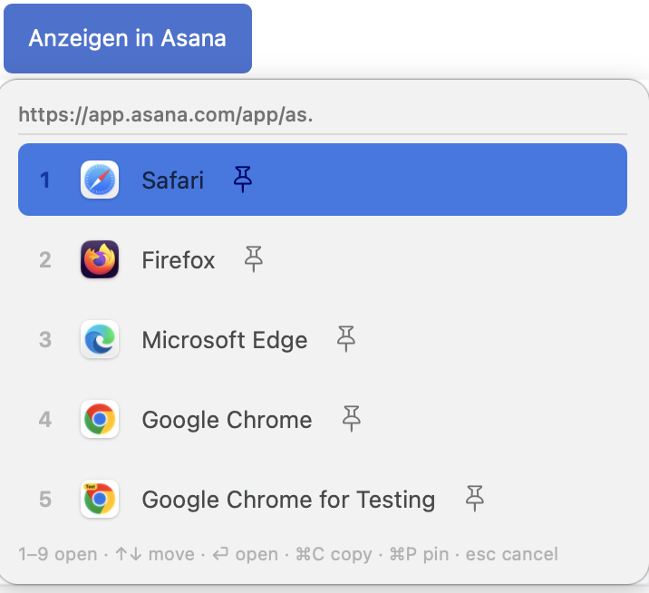

# BrowserProxy

A tiny macOS "default browser" that intercepts every link and hands it to the
real browser you actually want (Safari, Chrome, Firefox, Edge, …) — either
automatically via a rule, or through a fast picker.

Built for people who need a different browser depending on where a link came
from (customer mail, for example), even though macOS only allows _one_ default
browser.



## Features

- **Picker**: every link pops up a small floating window **at the mouse
  position**, listing all installed browsers.
  - Pick with a **number key (1–9)**, or arrow keys + **⏎**. **Esc** cancels.
  - The **full target URL** is visible (click the URL to expand it).
  - **⌘C** copies the URL to the clipboard.
  - **⌘R** opens `rules.json` to remove or pause a binding (the link is not opened).
- **Rules**: route by **URL pattern**, by the **source app** a link came from, or
  both. When a rule matches, the link opens **immediately, without the picker**:
  - _URL rule_ — `customer-x.com → Edge`, `localhost → Chrome`.
  - _App rule_ — `everything opened from Cursor → Chrome`, `Slack → Safari`.
  - _Combined_ — a URL pattern that only applies when opened from a given app.
- **Learning**: every picker row has **two toggle buttons**. A button marked
  **✓** (green) means that browser holds the binding. Click it to switch the
  binding on or off. The picker stays open, so you then pick the browser to open
  the link in.
  - **Domain** (URL pin) binds the current domain to that browser. **⌥-click**
    binds the _exact host_ only, and the button then reads **✓ Host**.
  - **App** (App pin) binds _every link from the app you clicked in_ to that
    browser. Shown only when the source app is known.
  - Keyboard: **⌘P** (domain, **⌥⌘P** exact host) or **⌘⇧P** (app) binds the
    selected browser _and_ opens the link in one step.
- **Bypass**: hold **⇧ (Shift)** while clicking a link to skip the rules and get
  the picker anyway — even for a domain (or app) a rule already owns.

### Cheat sheet: bind, change, remove

The picker footer shows these hints too; hover a **Domain** / **App** button for a tooltip.

| I want to…                                     | Do this                                                                                             |
| ---------------------------------------------- | --------------------------------------------------------------------------------------------------- |
| Always open **this domain** in a browser       | Click **Domain** in that browser's row (or press **⌘P** to bind and open). Covers all subdomains.  |
| Always open **only this exact host**           | **⌥-click Domain** (or **⌥⌘P**). `shop.x.com` is bound, `mail.x.com` is not.                       |
| Always open **every link from this app**       | Click **App** (or **⌘⇧P**). Only shown when the picker says `from <app>`.                          |
| See the picker again for a bound link          | Hold **⇧** while clicking the link.                                                                 |
| **Move** a binding to another browser          | Hold **⇧**, click the link, click **Domain** / **App** in the other browser's row.                  |
| **Switch a binding off**                       | Hold **⇧**, click the link, click the green **✓ Domain** / **✓ App** button.                        |
| **Delete** a binding for good                  | In the picker press **⌘R** → `rules.json` opens. Delete the rule's `{ … }` block and save.          |
| Remove **all** bindings                        | `rm ~/Library/Application\ Support/BrowserProxy/rules.json`                                         |

Edits to `rules.json` apply to the next link, no restart. Keep the
`{"version": 2, "rules": [...]}` wrapper and valid JSON (watch trailing commas
after deleting a block): a file that does not parse disables **all** rules. ⌘R
closes the picker without opening the link; click the link again afterwards.

To find a rule quickly, search `rules.json` for the domain (`"pattern"`) or for
the app's bundle ID (`"sourceAppBundleID"`), and check `browserBundleID` for the
target.

### Picker behaviour worth knowing

- Below the URL, the picker shows **`from <app>`** — the app the link was opened
  from (when it could be determined). That app is what the **App** button targets.
- The mouse works too: **click a row** to open it, **hover** to move the
  selection, **click Domain / App** to switch a binding on or off (**⌥-click**
  Domain for the exact host). The panel can be dragged around by its background.
- The picker **cancels when it loses focus** — click somewhere else and the link
  is dropped, not opened.
- If several links arrive at once, they are **queued**: you get one picker after
  another, in order.
- BrowserProxy **filters itself out** of the browser list, so it can never route
  a link back into itself.

## Installation

Requirements: macOS 26+, Xcode 26 / Swift 6.2+. There is no prebuilt release —
you build the app locally.

**1. Clone**

```sh
git clone https://github.com/sven09/browserproxy.git
cd browserproxy
```

**2. Build and install to `/Applications`**

```sh
./make-app.sh install
```

This builds the SwiftPM executable, wraps it (plus an Info.plist) into a
`BrowserProxy.app` bundle, ad-hoc signs it, copies it to `/Applications` and
registers that copy with LaunchServices — which is what makes it show up in
macOS's browser selection at all.

The bundle is **ad-hoc signed and not notarized**. That is fine for an app you
built yourself on this machine, and `make-app.sh install` also clears the
quarantine flag. But if you ever move the bundle to another Mac, Gatekeeper will
block it — build it there instead of copying it over.

Build only, without installing:

```sh
./make-app.sh             # result lands in .build/bundle/
```

The build deliberately goes to `.build/bundle/` and **not** the project root:
LaunchServices auto-registers every app bundle it notices, and two registered
copies sharing a bundle ID make it ambiguous which one macOS launches. Only the
installed copy in `/Applications` gets registered.

**3. Set as the default browser**

```sh
open -a /Applications/BrowserProxy.app --args --set-default
```

This makes the app request the macOS confirmation dialog (the request _has_ to
come from the app itself). Or do it by hand:
_System Settings → Desktop & Dock → Default web browser_ → **BrowserProxy**.

From then on every link (Mail, Slack, `open …` in the terminal, …) lands in the
picker or gets routed by a rule. Switch back any time via the same setting.

**4. Check it works**

```sh
open -a /Applications/BrowserProxy.app "https://example.com"    # shows the picker
```

> Tip: if BrowserProxy isn't offered after a rebuild, run `./make-app.sh install`
> again (it calls `lsregister -f`), or log out and back in.

### Uninstall

```sh
osascript -e 'quit app "BrowserProxy"'
rm -rf /Applications/BrowserProxy.app
rm -rf ~/Library/Application\ Support/BrowserProxy    # rules & preferences
```

Pick a real browser again under _System Settings → Desktop & Dock → Default web
browser_ first.

## Trying it without switching your default

The command from step 4 works while another browser is still the default, so you
can try everything out without changing your default browser.

To test a rule: add one to `~/Library/Application Support/BrowserProxy/rules.json`,
then open a matching URL — it should launch straight away, no picker.

## Quitting

The app has no menu bar icon (yet):

```sh
osascript -e 'quit app "BrowserProxy"'
```

## Configuration

Everything lives as JSON in `~/Library/Application Support/BrowserProxy/`. There
is no settings UI yet — you edit the files, or let the picker's pin action write
rules for you.

### `rules.json`

Changes take effect **immediately**: the app re-reads the file on every link, so
there is nothing to restart.

```json
{
  "version": 2,
  "rules": [
    {
      "id": "6C6F1B60-0F5B-4B1F-9A5E-8C3D2F5A1E77",
      "pattern": "customer-x.com",
      "matchType": "domainSuffix",
      "browserBundleID": "com.microsoft.edgemac",
      "enabled": true,
      "priority": 0,
      "createdAt": "2026-07-14T09:12:33Z"
    },
    {
      "id": "9B2F7A11-6E3C-4D5A-8F02-1C4B9D6E70A3",
      "sourceAppBundleID": "com.todesktop.230313mzl4w4u92",
      "browserBundleID": "com.google.Chrome",
      "enabled": true,
      "priority": 0,
      "createdAt": "2026-07-15T10:02:00Z"
    },
    {
      "id": "1E9A7C34-2D48-4F0A-B6C1-77E2A9D40B15",
      "pattern": "localhost",
      "matchType": "domain",
      "browserBundleID": "com.google.Chrome",
      "enabled": true,
      "priority": 10,
      "createdAt": "2026-07-14T09:14:02Z"
    }
  ]
}
```

The middle rule above is an **app rule**: every link opened from Cursor
(`com.todesktop.…`) goes to Chrome. Note the `{"version": 2, "rules": [...]}`
wrapper — a bare array is not accepted. `id` is any UUID and `createdAt` is an
ISO 8601 date. Files written by v1 (URL-only rules) still load unchanged.

Each rule declares a **URL condition** (`pattern` + `matchType`), a **source-app
condition** (`sourceAppBundleID`), or both. A rule must declare at least one; a
rule that declares neither never matches.

Fields per rule:

- `pattern` — the URL pattern to match (domain, host, glob or regex). Omit for an
  app-only rule.
- `matchType` — how `pattern` is compared; required whenever `pattern` is set:
  - `domain` — exact host equality (`localhost`, `192.168.1.10`).
  - `domainSuffix` — the host itself or any subdomain of it: `customer-x.com`
    also matches `shop.customer-x.com`.
  - `glob` — `*` (any run of characters) and `?` (one character), tried against
    the host first, then the whole URL: `*.internal.corp`.
  - `regex` — regular expression against the whole URL.
  - `exact` — the whole URL, character for character.
- `sourceAppBundleID` — bundle id of the app the link must have been opened from,
  e.g. `com.apple.mail`, `com.tinyspeck.slackmacgap`, `com.microsoft.VSCode`. Omit
  for a URL-only rule. Look one up with `osascript -e 'id of app "Cursor"'`, or
  just use the picker's **App pin**, which fills it in for you.
- `browserBundleID` — e.g. `com.apple.Safari`, `com.google.Chrome`,
  `org.mozilla.firefox`, `com.microsoft.edgemac`. To look one up:
  `osascript -e 'id of app "Google Chrome"'`.
- `enabled` — `false` parks a rule without deleting it.
- `priority` — integer, higher is checked first (see below).
- `createdAt` — ISO 8601; used as the final tie-breaker.

> **A malformed `rules.json` is silently ignored.** If the JSON does not parse or
> a required field is missing, the app behaves as if there were no rules at all
> and shows the picker for everything. If a rule you added seems to do nothing,
> suspect the file before you suspect the pattern — the whole file is out, not
> just that rule.

### Which rule wins

The first match in this order routes the URL:

1. **`priority`**, highest first. This overrides everything below, so a
   high-priority URL rule can still beat an app rule if you want it to.
2. **App before URL**, when priorities are equal: a rule with a
   `sourceAppBundleID` outranks a rule without one. So `Cursor → Chrome` wins over
   `github.com → Firefox` when you click a github link _inside_ Cursor. A
   **combined** rule (app _and_ URL) is more specific still and beats a plain app
   rule.
3. **Specificity** among URL conditions: `exact` > `regex` > `glob` > `domain` >
   `domainSuffix`, and within the same type the longer pattern wins. So
   `shop.customer-x.com` beats `customer-x.com` without touching `priority`.
4. **Age**, as the final tie-breaker: the older rule wins.

An app rule only applies when BrowserProxy could tell **which app the link came
from** — the app that was frontmost the moment you clicked. Links from a source
with no meaningful frontmost app (`open …` from a background script, some
notifications) fall through to URL rules / the picker.

If a matching rule points at a browser that is **no longer installed**, it is
skipped and the next match is tried — a stale rule falls through to the picker
rather than failing.

### Changing a rule without editing JSON

Once a rule matches, that domain never reaches the picker again — so to change it,
you first have to get the picker back:

1. **Hold ⇧ while clicking the link.** Keep holding it as you click; the rules
   are skipped and the picker appears.
2. **Click Domain or App in the row of the browser you want.** The green ✓ moves
   to that row; the existing rule is rewritten rather than duplicated. Click the
   green button again to switch the binding off. Then open the link by clicking
   the row, or press **⌘P** / **⌘⇧P** to bind and open in one step.

By default, the URL pin binds the **domain**, including its subdomains. For
example, pinning `shop.customer-x.com/orders/42` normally binds
`customer-x.com`, so other pages and subdomains use that browser too. Hold **⌥**
while pinning (⌥-click **Domain**, or ⌥⌘P) to bind only the exact host
`shop.customer-x.com`; it still applies to every path on that host. `localhost`
and IP addresses are always pinned as exact hosts. A single URL path is not a
pin option; use an `exact`, `glob`, or `regex` rule in `rules.json` for that.

### Remove or pause a binding

To **pause** a binding, hold ⇧ while clicking the link and click the green
**✓ Domain** / **✓ App** button. That sets `"enabled": false` in `rules.json`; the
rule stays there and clicking the button again switches it back on.

To **delete** a rule, or pause one the buttons don't cover (hand-written
`glob`, `regex`, `exact` or combined app + URL rules), edit the file:

1. Open the rules file: press **⌘R** in the picker (it closes without opening
   the link), or from the terminal:

   ```sh
   open -e "$HOME/Library/Application Support/BrowserProxy/rules.json"
   ```

2. Find the rule you want to change. URL pins have a `pattern` and `matchType`
   but no `sourceAppBundleID`; app pins have `sourceAppBundleID` but no
   `pattern`.
3. To **remove** it, delete that rule's whole `{ ... }` object from the
   `"rules"` array. Keep commas between remaining rules, and leave the outer
   `{"version": 2, "rules": [...]}` structure intact. Save the file.
   To **pause** it instead, change `"enabled": true` to `"enabled": false`;
   change it back to `true` to restore it.

Edits take effect on the next link; BrowserProxy re-reads `rules.json` each
time, so no restart is needed. If you remove a rule but still have a broader
URL or app rule, that other rule may continue routing the link. To make a link
show the picker, remove or disable every matching rule. For one link only, hold
⇧ while clicking it to bypass all rules without changing them.

Deleting a rule, combining app + URL into one rule, or changing `glob`, `regex`,
`priority` or `enabled` still requires editing `rules.json`.

The bypass modifier is configurable — see `bypassModifier` below. Note it is read
at the moment the link arrives, so you have to be _holding_ the key as you click,
not press it afterwards.

### What pinning writes

The **Domain** button (or ⌘P) creates a `domainSuffix` rule for the
**registrable domain**, so pinning `shop.customer-x.com` writes `customer-x.com`
and thereby also covers `mail.customer-x.com`. Multi-label public suffixes are
handled, so `shop.example.co.uk` writes `example.co.uk` and not `co.uk` — though
the list of those suffixes is a common-cases table, not the full Public Suffix
List. Hold **⌥** while pinning to write a `domain` rule for the **exact host**
instead. `localhost` and IP literals are always pinned exactly.

The **App** button (or ⌘⇧P) creates an app-only rule for the source app —
`sourceAppBundleID` set, no `pattern`. It is offered only when the source app is
known (the picker shows `from <app>`).

Pinning the same target twice does not create a duplicate rule. Switching a
button off sets `"enabled": false` on the rule instead of deleting it. The Domain
button only tracks the two rule shapes it writes (domain suffix and exact host);
a hand-written rule for the same site does not show as ✓.

### `preferences.json`

Written with defaults on first launch. Unlike rules, these are read at startup —
quit the app to apply changes.

```json
{
  "version": 1,
  "showFullURLByDefault": false,
  "quitAfterOpen": false,
  "bypassModifier": "shift",
  "fallbackBrowserBundleID": "com.apple.Safari"
}
```

- `showFullURLByDefault` — show the full URL expanded in the picker right away.
- `quitAfterOpen` — quit the app after each open instead of staying resident in
  the background.
- `bypassModifier` — the key that forces the picker when held while a link is
  clicked: `"shift"` (default), `"option"`, `"control"` or `"command"`. Set it to
  `null` to switch the bypass off. Which key is safe depends on where you click
  links: `"control"` is a right-click substitute on macOS and `"option"` already
  means *exact host* when pinning, so shift is the least surprising choice.
- `fallbackBrowserBundleID` — optional. Browser for URLs **without a host** (rare,
  but they exist), which would otherwise get a picker. Omit the key to always show
  the picker.

## Troubleshooting

The app has no UI for errors; it logs to the unified log. To watch it:

```sh
log stream --predicate 'process == "BrowserProxy"'
```

- **A rule does nothing** → `rules.json` probably does not parse; see the warning
  above.
- **A `regex` rule never matches** → an invalid pattern is treated as "no match",
  silently. Test the expression before you commit to it.
- **Nothing happens when a link is clicked** → the log will say
  `no browsers found` if LaunchServices reports no browser other than
  BrowserProxy itself; the URL is dropped in that case.
- **An app rule does nothing / the App pin is missing** → BrowserProxy could not
  determine the source app (the picker shows no `from <app>` line). This happens
  when the link comes from something with no frontmost app — a background `open`,
  some notifications. There is no app to key the rule on in that case.
- **BrowserProxy is not offered as a default browser** → re-run
  `./make-app.sh install` (which calls `lsregister -f`), or log out and back in.

## Structure

Plain AppKit (no storyboard/xib), an accessory app with no dock icon, running
resident in the background.

| File                                                           | Purpose                                                                       |
| -------------------------------------------------------------- | ----------------------------------------------------------------------------- |
| `main.swift`                                                   | app bootstrap, `.accessory` policy                                            |
| `AppDelegate.swift`                                            | URL intake (`application(_:open:)` + AppleEvent fallback), routing, URL queue |
| `BrowserRegistry.swift`                                        | find installed browsers (filtering itself out)                                |
| `SourceApp.swift`                                             | detect which app a link was opened from (frontmost at intake)                 |
| `Rule.swift` / `RuleStore.swift`                               | rule model (URL + app matching), matching, persistence                        |
| `PreferencesStore.swift`                                       | preferences                                                                   |
| `PickerController.swift` / `PickerPanel.swift` / `Views.swift` | picker window, keyboard, cursor position                                      |
| `Launcher.swift`                                               | opening in the chosen browser                                                 |
| `make-app.sh`                                                  | builds the `.app` bundle + Info.plist + LaunchServices registration           |

## Limitations

- No menu bar icon and no settings window — preferences are a JSON file.
- No rule editor. Pinning creates and re-targets rules (⇧ + pin, see above), but
  deleting a rule or setting `priority`, `enabled`, `glob` or `regex` means
  editing `rules.json` (⌘R in the picker opens it).
- No automated tests.

## License

[MIT](LICENSE) © Sven Herchenhein
